# 🛡️ Awesome Cloud Workload Protection Platform (CWPP)

  

  
  
  
  
  
  

> **Curated directory of premier Cloud Workload Protection Platforms (CWPP), Cloud Detection and Response (CDR), Container Security, eBPF Telemetry, and Serverless Defense tools.**

## 📌 Executive Summary

Modern enterprise workloads span virtual machines, Kubernetes clusters, serverless containers, and hybrid data centers. **Cloud Workload Protection Platforms (CWPP)** safeguard workloads at runtime—detecting and intercepting ransomware, cryptomining, container escapes, fileless exploits, and privilege escalations.

This repository catalogs industry-leading **SaaS enterprise suites** (with granular pricing and trial terms) and battle-tested **open-source security engines** (sorted by GitHub star count).

## 📑 Table of Contents

- [📊 Sector Overview & Market Dynamics](#-sector-overview--market-dynamics)
- [🏢 SaaS & Hosted Commercial Platforms](#-saas--hosted-commercial-platforms)
- [🔓 Open-Source GitHub Projects](#-open-source-github-projects)
- [📈 Star History](#-star-history)
- [🤝 How to Contribute](#-how-to-contribute)
- [💖 Support & Community](#-support--community)
- [⚖️ Disclaimer](#-disclaimer)

## 📊 Sector Overview & Market Dynamics

The global Cloud Workload Protection Platform (CWPP) market is estimated at approximately **$5.7B to $10.3B** (projected to reach over $30B by the early 2030s at an aggressive ~20–23% CAGR), driven by multi-cloud expansion, containerized microservices, and serverless architectures. The sector is **moderately fragmented and intensely competitive** rather than a winner-take-all market, marked by consolidation into CNAPP suites where hyperscalers (like Microsoft Defender for Cloud), pure-play cloud security pioneers (such as Wiz and Aqua Security), and enterprise cybersecurity incumbents (Palo Alto Networks, CrowdStrike, SentinelOne) vie for market share alongside an active open-source ecosystem.

## 🏢 SaaS & Hosted Commercial Platforms

| Company Size (Revenue / Valuation) | Product / Platform | Pricing (Specific Starting Tiers) | Free Tier / Trial Limits | Key Capabilities & Trade-offs |
| :--- | :--- | :--- | :--- | :--- |
| **~$3.0T Market Cap** / ~$245B Ann. Rev. | **[Microsoft Defender for Servers](https://azure.microsoft.com/en-us/products/defender-for-cloud)** | **Plan 1**: ~$0.0067/server/hr (~$4.91/server/mo); **Plan 2**: ~$0.020/server/hr (~$14.60/server/mo) billed on active server uptime. | **30-day free trial** per plan with full features; foundational CSPM is permanently free. | Host & container protection across Azure, AWS, GCP & on-prem. Plan 2 required for agentless network-layer detection. |
| **~$110B Market Cap** / ~$8.0B Ann. Rev. | **[Prisma Cloud Compute](https://www.paloaltonetworks.com/prisma/cloud)** (Palo Alto Networks) | Credit-based licensing; modular entry configurations starting at **~$18,000/year** (CSPM) to **~$45,000/year** (full CNAPP suite). | **30-day free trial / PoC** via AWS Marketplace and direct sales; no permanent free tier. | Comprehensive host, container, and serverless runtime protection; available as SaaS (Enterprise) or self-hosted/air-gapped (Compute). |
| **~$80B Market Cap** / ~$4.0B Ann. Rev. | **[CrowdStrike Falcon Cloud Workload Protection](https://www.crowdstrike.com/)** | Flex licensing starts at **~$233.99/year** per host/workload license (via CDW); enterprise bundles quote-based. | **15-day free trial** with full cloud runtime detection and response access; no permanent free tier. | Unified agent-based breach prevention across VMs, containers, and K8s; requires Falcon platform base. |
| **~$55B Market Cap** / ~$5.5B Ann. Rev. | **[Lacework FortiCNAPP](https://www.lacework.com/)** (Fortinet) | Entry software licenses & starter deployment bundles starting at **~$22,000/year**; custom private offers via AWS Marketplace. | **30-day free trial** via AWS Marketplace and Fortinet portal; no permanent free tier. | AI-driven behavioral anomaly detection and Polygraph correlation uniting CWPP, CSPM, and CIEM; post-acquisition Fortinet integration. |
| **~$15B Market Cap** / ~$1.7B Ann. Rev. | **[SentinelOne Singularity Cloud Workload Security](https://www.sentinelone.com/)** | Cloud workload protection benchmarked starting at **~$36.00/VM/month** (~$432/VM/year); custom contract private offers on AWS Marketplace. | **30-day free evaluation / PoC** available through enterprise request; no permanent free tier. | Autonomous runtime protection and active rollback for servers, VMs, and Kubernetes against ransomware and fileless exploits. |
| **~$12B Valuation** (Private) / ~$500M+ ARR | **[Wiz Defend](https://www.wiz.io/)** | **Wiz Essential** starts at **$24,000/year** (min. 100 workloads @ $240/workload/yr); **Wiz Advanced** starts at **$38,000/year** (100 workloads). | **14-day free trial / PoC** with agentless visibility and Wiz Signals threat lake; no permanent free tier. | 100% agentless workload risk analysis complemented by lightweight Wiz Sensor runtime detection; high multi-cloud visibility. |
| **~$6.5B Market Cap** / ~$1.8B Ann. Rev. | **[Trend Micro Cloud One – Workload Security](https://www.trendmicro.com/)** | Hourly Pay-As-You-Go starts at **$0.007/instance/hr** (Essentials) up to **$0.011/instance/hr** (Medium/1 vCPU) and **$0.032/instance/hr** (Large). Annual licenses ~$385–$435/device. | **30-day free trial** with full protection-hours access on AWS Marketplace; no permanent free tier. | Mature runtime IPS/IDS, integrity monitoring, anti-malware, and container security with rich automation APIs. |
| **~$5.0B Market Cap** / ~$850M Ann. Rev. | **[Tenable Cloud Workload Protection](https://www.tenable.com/)** | Scoped per protected asset/resource, typically spanning **$28 to $90/asset/year** depending on volume; annual minimum contracts apply. | **Custom demo / scoped PoC** through sales; permanent free tier for standalone Nessus Essentials (limited to 16 IPs, vulnerability scanning only). | Scans virtual machines, container registries, and serverless functions for CVEs, secrets, and toxic combinations in multi-cloud assets. |
| **~$3.0B Valuation** (Private) / ~$300M+ ARR | **[Sysdig Secure](https://sysdig.com/)** | Node-based subscription starting at **$72.00 per host/month** (~$864/host/year) on AWS Marketplace (often with 20-host commitment tiers). | **30-day free trial** with full runtime policies; open-source Falco engine is **100% free forever** for self-hosting. | Built natively on CNCF Falco eBPF telemetry with 100+ out-of-the-box MITRE ATT&CK runtime rules and Kubernetes drift prevention. |
| **~$1.0B Valuation** (Private) / ~$100M+ ARR | **[Aqua Security](https://www.aquasec.com/)** | AWS Marketplace starting tiers: Shift Left Standard **$50,000/year**, Protect Advanced **$100,000/year**, and Ultimate **$150,000/year**. | **Custom 14- to 30-day guided PoC** on request; **Trivy open-source engine is 100% free forever** (unlimited scans). | Enterprise container, K8s, and AI workload runtime security with FedRAMP High authorization and granular supply chain controls. |

## 🔓 Open-Source GitHub Projects

Explore top-tier open-source Cloud Workload Protection Platforms, runtime security sensors, eBPF telemetry hooks, and Kubernetes security engines sorted by GitHub community star count:

1. **[Trivy](https://github.com/aquasecurity/trivy)** 
   - **Vulnerability, Misconfiguration & SBOM Scanner** (Apache-2.0, CNCF) — The most widely deployed security scanner for container images, file systems, Git repositories, virtual machine disks, and Kubernetes clusters.
   - **Capabilities**: Comprehensive shift-left and runtime scanning, CVE detection, SBOM generation (SPDX/CycloneDX), secret detection, and Kubernetes cluster scanning via Trivy Operator.
   - **Tech Stack**: Go | **Deployment**: CLI, CI/CD pipeline, Kubernetes Operator | **Best for**: Shift-left container security and vulnerability auditing.

2. **[Wazuh](https://github.com/wazuh/wazuh)** 
   - **Open-Source XDR & SIEM Workload Protection** (GPL-2.0) — Unified host-based workload protection providing runtime security monitoring, file integrity monitoring (FIM), intrusion detection (HIDS), and compliance verification across physical, virtual, and cloud workloads.
   - **Capabilities**: Active response to terminate threats, vulnerability detection, log data analysis, regulatory compliance monitoring (PCI DSS, HIPAA, CIS Benchmarks), and multi-cloud telemetry.
   - **Tech Stack**: C, Python, Go | **Deployment**: Agent on Linux/Windows/macOS, central indexer/server | **Best for**: Unified host workload defense and compliance across hybrid cloud infrastructure.

3. **[Kubescape](https://github.com/kubescape/kubescape)** 
   - **Kubernetes Open-Source Security Platform** (Apache-2.0, CNCF Incubating) — Provides multi-cloud Kubernetes posture management, container scanning, and runtime threat detection powered by eBPF.
   - **Capabilities**: Risk scoring, CIS benchmark compliance, RBAC visualization, image vulnerability scanning, network policy generation, and eBPF runtime malware detection.
   - **Tech Stack**: Go | **Deployment**: CLI, Helm chart, In-cluster operator | **Best for**: Dedicated, end-to-end Kubernetes cluster and workload hardening.

4. **[Falco](https://github.com/falcosecurity/falco)** 
   - **Cloud-Native Runtime Threat Detection Engine** (Apache-2.0, CNCF Graduated) — The industry standard for Linux and Kubernetes runtime behavioral security and system call inspection.
   - **Capabilities**: Kernel system call monitoring via eBPF/kmod, rich YAML rule language mapping to MITRE ATT&CK, plugin ecosystem for AWS CloudTrail/Okta/GitHub audit logs, and 100+ alert forwarding integrations.
   - **Tech Stack**: C++, Go | **Deployment**: DaemonSet on K8s, standalone package | **Best for**: Real-time detection of container escapes, reverse shells, privilege escalations, and cryptojackers.

5. **[Kyverno](https://github.com/kyverno/kyverno)** 
   - **Cloud-Native Kubernetes Policy Engine** (Apache-2.0, CNCF Graduated) — Purpose-built policy engine for Kubernetes admission control, runtime workload policy validation, mutation, and generation without requiring learning complex DSLs.
   - **Capabilities**: Enforces security best practices (blocking root containers, validating read-only root filesystems), verifies container image signatures via Sigstore/Cosign, and generates cleanup policies.
   - **Tech Stack**: Go | **Deployment**: In-cluster Kubernetes admission controller | **Best for**: Enforcing security guardrails and supply-chain verification at the Kubernetes admission gate.

6. **[Cloud Custodian](https://github.com/cloud-custodian/cloud-custodian)** 
   - **Rules Engine for Cloud Security & Compliance** (Apache-2.0, CNCF) — Lightweight governance engine for managing public cloud workloads across AWS, Azure, and GCP through simple YAML policies.
   - **Capabilities**: Real-time compliance monitoring, resource inventory filtering, automated remediation (tagging, stopping unencrypted instances, quarantining security groups), and cost controls.
   - **Tech Stack**: Python | **Deployment**: Serverless functions (AWS Lambda/Cloud Functions), CLI, CI/CD | **Best for**: Multi-cloud workload posture management and automated resource remediation.

7. **[Tetragon](https://github.com/cilium/tetragon)** 
   - **eBPF-Based Security Observability & Runtime Enforcement** (Apache-2.0, Cilium/Isovalent) — High-performance kernel-level runtime enforcement engine with real-time kill capabilities.
   - **Capabilities**: In-kernel process termination (stops threats before syscall completion), deep Kubernetes-aware process, namespace, and network visibility, and declarative TracingPolicy CRDs.
   - **Tech Stack**: Go, C (eBPF) | **Deployment**: Kubernetes DaemonSet | **Best for**: Low-overhead runtime blocking and real-time active containment at the kernel boundary.

8. **[Tracee](https://github.com/aquasecurity/tracee)** 
   - **eBPF Runtime Security & Forensics Sensor** (Apache-2.0, Aqua Security) — Collects rich system-level telemetry and detects suspicious runtime behaviors in real time.
   - **Capabilities**: Signature engine written in Go and Rego, detection of fileless execution, memory injection, kernel exploits, container escapes, and rich forensic timeline generation.
   - **Tech Stack**: Go, C (eBPF) | **Deployment**: Container, CLI, DaemonSet | **Best for**: Threat investigation, forensic capture, and eBPF-based container threat intelligence.

9. **[Gatekeeper](https://github.com/open-policy-agent/gatekeeper)** 
   - **OPA-Driven Policy Controller for Kubernetes** (Apache-2.0, CNCF) — Enforces declarative policies and security constraints on cloud workloads using Open Policy Agent (OPA) and Rego.
   - **Capabilities**: Validating and mutating webhook enforcement, continuous audit of existing Kubernetes resources against security policies, and parameterized ConstraintTemplates.
   - **Tech Stack**: Go, Rego | **Deployment**: In-cluster admission controller | **Best for**: Enterprises standardizing policy-as-code across heterogeneous cloud environments.

10. **[KubeArmor](https://github.com/kubearmor/KubeArmor)** 
    - **LSM-Based Container Runtime Policy Enforcement** (Apache-2.0, CNCF Sandbox) — Enforces least-privilege access controls at the Linux Security Modules (AppArmor, SELinux, BPF-LSM) layer.
    - **Capabilities**: Restricts process execution, sensitive file access, and socket creation within pods; telemetry exporting via gRPC to SIEM/observability systems; zero-trust runtime policy engine.
    - **Tech Stack**: Go, C | **Deployment**: Kubernetes DaemonSet | **Best for**: Kernel-enforced zero-trust sandboxing and workload isolation.

11. **[NeuVector](https://github.com/neuvector/neuvector)** 
    - **Full-Lifecycle Container Security Platform** (Apache-2.0, SUSE) — Open-source end-to-end container security featuring Layer 7 container firewalling, vulnerability management, and runtime protection.
    - **Capabilities**: Deep packet inspection (DPI) container firewall, behavioral baselining, automated process and file integrity protection, and CIS benchmark scanning.
    - **Tech Stack**: C, C++, Go | **Deployment**: Kubernetes DaemonSet/Operator | **Best for**: Full-stack container network security, runtime firewalling, and packet-level inspection.

12. **[container-runtime-security](https://github.com/aiagentmackenzie-lang/container-runtime-security)** 
    - **eBPF Container Runtime Monitoring & AI Triage** — Real-time event monitoring with multi-signal correlation and AI triage advisory.
    - **Capabilities**: 30 detection rules covering cryptojacking, reverse shells, container drift, and process injection; TC-based network blocking; ~73k events/sec throughput.
    - **Tech Stack**: Go, C (eBPF) | **Deployment**: Kubernetes DaemonSet | **Best for**: AI-assisted eBPF runtime detection and telemetry experimentation.

## 📈 Star History

## 🤝 How to Contribute

Contributions are warmly welcomed! Help keep this guide up-to-date and comprehensive:

1. 🍴 Fork this repository.
2. 🌿 Create a feature branch (`git checkout -b feature/new-cwpp-entry`).
3. 📝 Add or update tools following the existing format (include product name, URL, specific pricing details, free tier terms, or open-source star badges).
4. 🚀 Commit your changes and push to your branch.
5. 📬 Open a descriptive Pull Request.

## 💖 Support & Community

Thank you for exploring this curated repository! If you find this resource valuable for your cloud workload security architecture:

- 🌟 **Star this repository** to bookmark and show your support!
- 🍴 **Fork and share** it with your security, DevOps, and cloud engineering peers.
- 💬 **Join our community on Discord**: [Join the Server](https://discord.gg/jc4xtF58Ve)
- ☕ **Support the maintainer**: If you would like to buy a coffee or sponsor continuous updates, visit the [GitHub Sponsor Dashboard](https://github.com/sponsors/ishandutta2007).

## ⚖️ Disclaimer

- This is a **community-curated** list — not exhaustive and not a commercial endorsement.
- CWPP platforms handling workload credentials and runtime telemetry must comply with corporate governance and data protection regulations (GDPR, HIPAA, SOC 2, CCPA).
- **Runtime Detection vs. Enforcement vs. Scanning**: Open-source tools like **Falco** and **Tracee** focus on **detection** (alerting on anomalies). Engines like **Tetragon** and **KubeArmor** perform **enforcement** (blocking malicious activity in-kernel). Tools like **Trivy** handle **build-time scanning**. Compose these components into an integrated defense-in-depth pipeline tailored to your infrastructure.

---

  <b>Built with ❤️ for Cloud Security Engineers, Platform Teams, and DevSecOps Practitioners worldwide.</b>

